# vlm_av_ws

A ROS2 (Humble) + Gazebo (Fortress) autonomous-driving simulation: a full-size sedan drives a generated urban road course with vision-based lane perception, a curvature-aware local planner and an OSQP model-predictive controller.
On top of that core, four demo modes show different features: a vision-language model that reads road signs, automatic emergency braking (AEB) on the depth camera or on a front lidar, and lidar adaptive cruise control (ACC) behind a moving lead truck.

This project is a continuation of [kfan12/vlm_robot_public](https://github.com/kfan12/vlm_robot_public), rebuilt around a full-size sedan (Ackermann steering, RGB-D front camera) and a more realistic generated road world.

**Status: under active development.** Expect frequent changes to perception, control and feature tuning.

## Demo modes

| Mode | What it shows | World (default) |
| --- | --- | --- |
| [**vlm**](#vlm-road-signs-set-the-speed) | Qwen2.5-VL reads road signs and turns them into speed caps and a stop | `urban_course` |
| [**aeb**](#aeb-emergency-braking-on-the-depth-camera) | emergency braking for a barrier in the lane, from the depth camera | `urban_course_roadblock` |
| [**lidar**](#lidar-emergency-braking-on-the-front-lidar) | the same emergency braking from a front lidar | `urban_course_roadblock` |
| [**acc**](#acc-adaptive-cruise-behind-a-lead-truck-in-development) | adaptive cruise control following a lead truck (in development) | `urban_course` |

The modes never run together; each is one command (see [Running the demos](#running-the-demos)).
In all of them the car steers by lane following alone; the features only ever limit its speed or stop it.

### vlm: road signs set the speed

A vision-language model (Qwen2.5-VL-3B) reads the road signs along the course (right, left, winding, stop) from the front camera.
Each sign becomes a speed cap or a stop, so the car slows for the turns and the winding section and stops at the end of the course (straight -> right 90 -> winding S -> left 90 -> STOP).

| Gazebo simulation | RViz (lane debug image + planned path) |
| --- | --- |
| 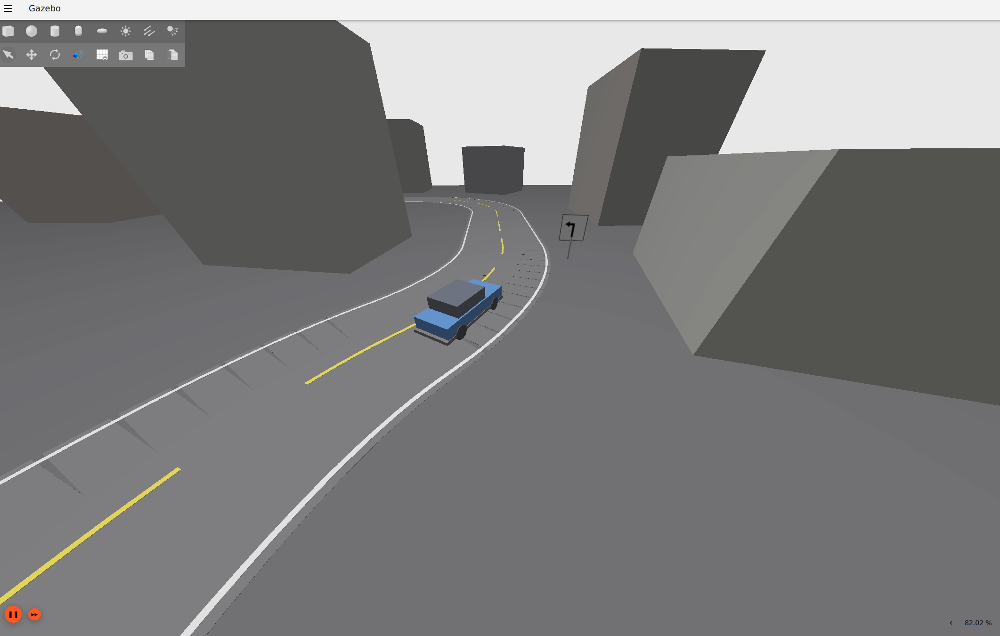 | 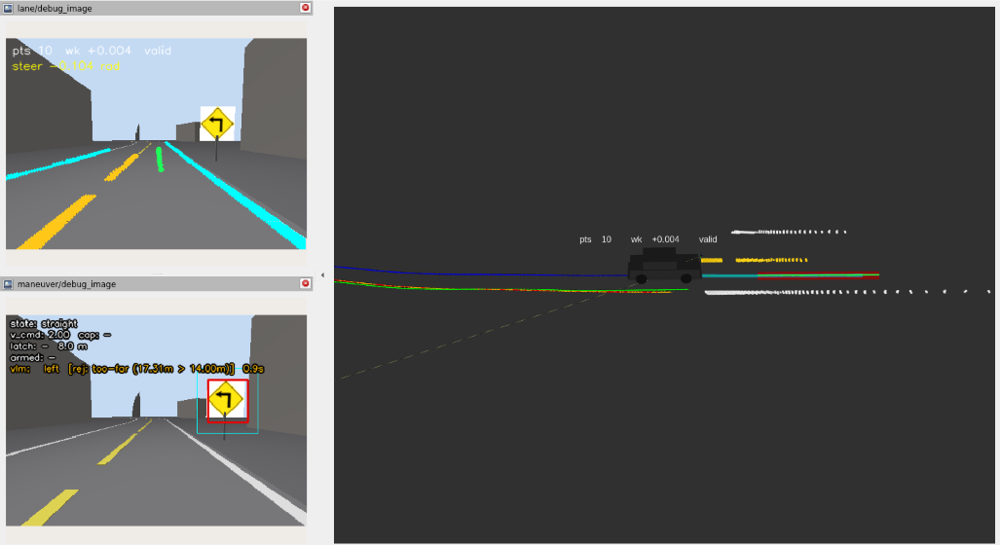 |

### aeb: emergency braking on the depth camera

A barrier blocks the lane ahead.
The lane-following chain does not know about it and keeps asking for speed, so stopping is entirely up to the AEB node, which watches the car's predicted path, and a control arbiter, which decides which command reaches the car.

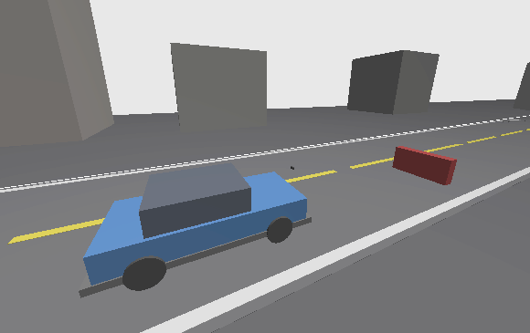

The AEB debug image (in RViz) shows the predicted path's corridor, the safe braking distance (yellow line) and the obstacles, with the state in the banner:

| MONITORING: path clear | WARNING: obstacle ahead, advisory |
| --- | --- |
| 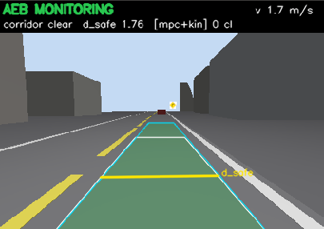 | 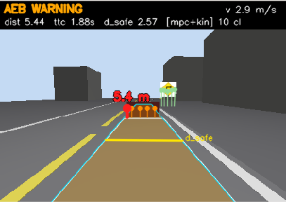 |
| **BRAKING: emergency stop** | **STOP_HOLD: held until the path is clear** |
| 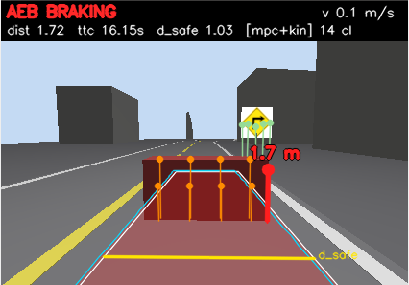 | 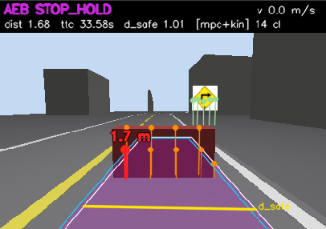 |

If a sensor or odometry goes stale, AEB faults and the arbiter stops the car: no AEB means no driving.

### lidar: emergency braking on the front lidar

The same AEB, fed by a front-grille lidar instead of the depth camera; everything after the obstacle detection is shared, and in closed-loop tests both sensors stop the car in the same places.

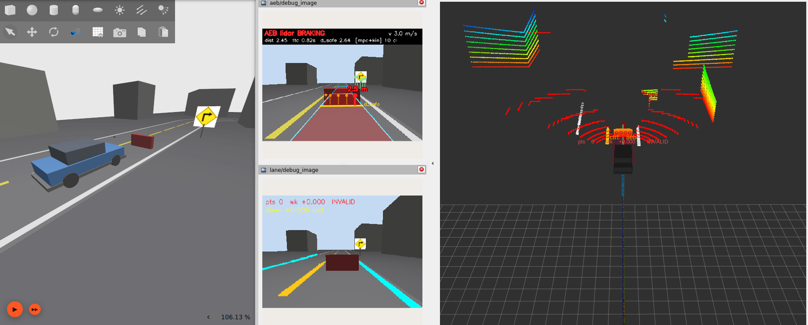

Left, Gazebo; middle, the AEB debug image (`AEB lidar BRAKING`) and the lane debug image; right, RViz with the lidar cloud coloured by height and the arbiter's `ctrl: aeb` label above the car.

### acc: adaptive cruise behind a lead truck (in development)

A lead truck drives ahead in the ego lane.
ACC tracks it with the lidar and keeps a time gap behind it by lowering the car's speed limit; emergency braking stays with AEB, which still runs underneath.

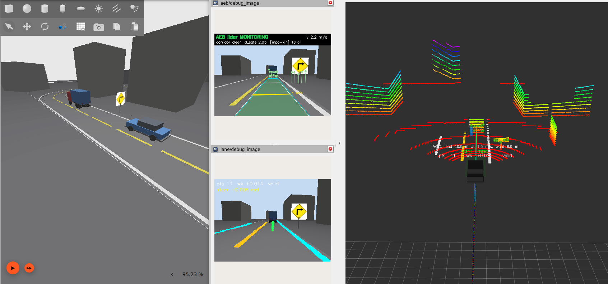

Left, Gazebo: the sedan following the truck toward the right turn; middle, the AEB debug image (`AEB lidar MONITORING`: the truck is ahead, but outside the braking corridor) and the lane debug image; right, RViz with the lidar cloud and ACC's label above the car, `ACC: lead 10.5 m at 1.5 m/s, want 8.9 m` (the gap, the truck's speed and the gap ACC is closing to), while the MPC drives (`ctrl: mpc`).

ACC follows the truck through the turn without contact, but it is still being validated: its gap estimate sometimes reads a few metres short for a moment, and the car then slows down behind a truck it was following steadily.

## How it works

### System architecture

Every box is a ROS2 node, tied together only by topics.
Solid arrows run in every mode; dashed arrows only in the modes named on them.

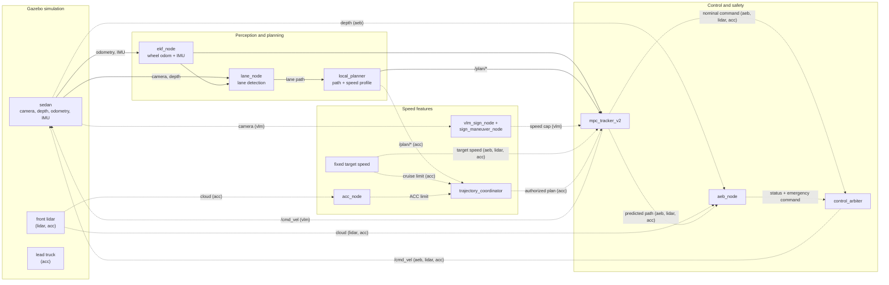

### Who decides the speed and the command

Speed features only lower the planner's speed profile before the MPC; the arbiter then decides, every tick, which command reaches the car.

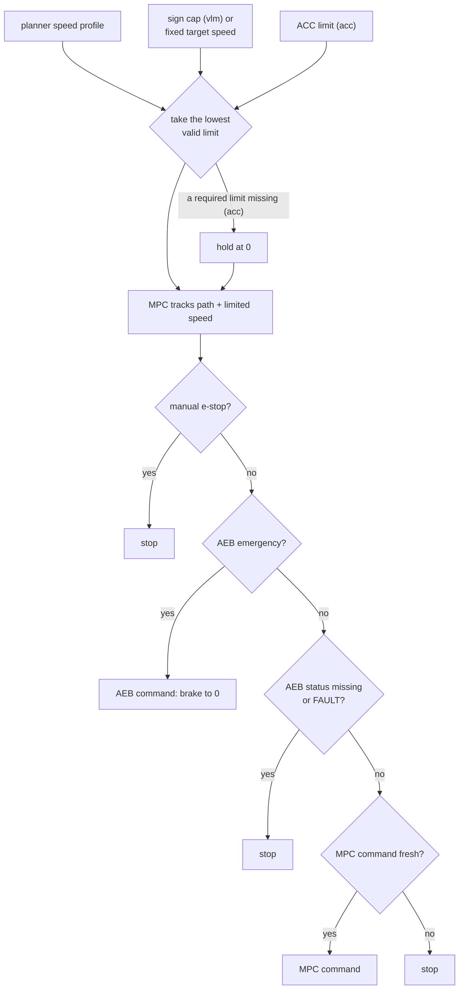

In the vlm mode there is no AEB and no arbiter: the MPC's command goes to the car directly.

### AEB state machine

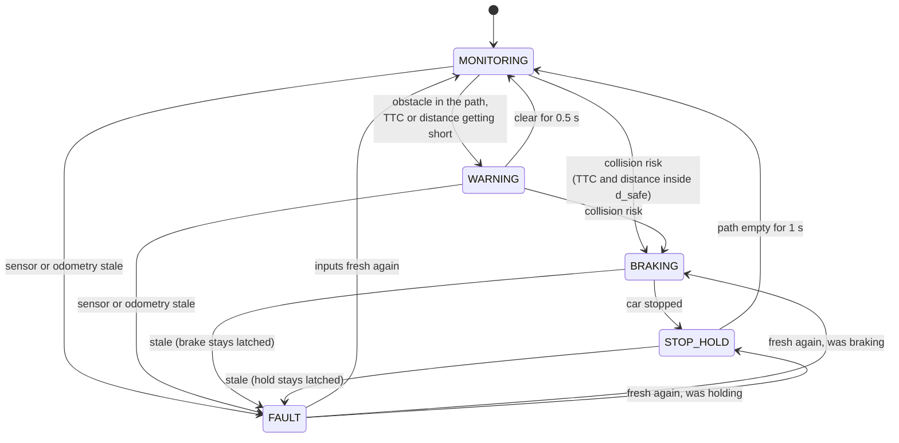

Entering WARNING or BRAKING needs the condition on 3 ticks in a row, so one noisy frame never triggers a brake; BRAKING never releases while the car is moving, and a fault never releases a brake or a hold.

### ACC pipeline

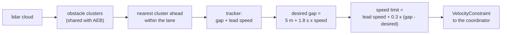

No lead means no limit; a gap under 3 m means a limit of 0.

## Running the demos

Build once:

```bash
cd ~/vlm_av_ws
colcon build --symlink-install
source install/setup.bash
chmod +x ./scripts/*.sh        # if a Windows-side checkout dropped the executable bit
```

Each demo opens one `terminator` window (needs `terminator` and an X server; WSLg on Windows 11 provides one) with the simulation, Gazebo, RViz and live status panes:

```bash
./scripts/start_course_demo.sh vlm      # road signs (default mode; needs the VLM venv below)
./scripts/start_course_demo.sh aeb      # depth AEB at the roadblock
./scripts/start_course_demo.sh lidar    # lidar AEB at the roadblock
./scripts/start_course_demo.sh acc      # lidar ACC behind a lead truck
./scripts/start_course_demo.sh -h       # every mode, pane and option
```

Close the window (or Ctrl-C in pane 2) to stop everything.

| Pane | vlm | aeb / lidar | acc |
| --- | --- | --- | --- |
| 1 | VLM nodes | the fixed target speed | spawns and drives the lead truck, then the cruise speed |
| 2 | the simulation stack | the simulation stack | the simulation stack |
| 3 | sign and maneuver narrative | AEB state changes | ACC: gap, lead speed, speed limit, AEB state |
| 4 | speed setpoint and raw sign reads | who controls the car, and its command | who controls the car, and its command |
| 5 | topic rates | topic rates | topic rates |
| 6 | shell with handy commands | shell with handy commands | shell with handy commands |

Common options (environment variables):

```bash
DEMO_WORLD=urban_tight ./scripts/start_course_demo.sh vlm                     # another world
DEMO_WORLD=urban_course_roadblock_oncoming ./scripts/start_course_demo.sh aeb  # barrier in the oncoming lane: must not brake
DEMO_SPEED=2.0 ./scripts/start_course_demo.sh aeb                             # lower the target speed (default: planner speed)
STACK_NOWAIT=1 ./scripts/start_course_demo.sh vlm                             # don't wait for Qwen to load
DEMO_LEAD_PROFILE=0:2.0,20:2.0,21:0.0,30:0.0,32:2.0 ./scripts/start_course_demo.sh acc   # lead stops, then goes again
DEMO_LEAD_S=40 ./scripts/start_course_demo.sh acc                             # lead starts further ahead
DEMO_LEAD=0 ./scripts/start_course_demo.sh acc                                # no lead: the car just cruises
DEMO_GZ_GL=software ./scripts/start_course_demo.sh lidar                      # Gazebo rendering on the CPU
DEMO_RVIZ=false ./scripts/start_course_demo.sh aeb                            # no RViz
```

**Rendering.** The short-track `aeb` and `lidar` demos render Gazebo on the GPU (Mesa d3d12 under WSLg), which roughly halves Gazebo's CPU load; `vlm` and `acc` use software rendering (`DEMO_GZ_GL=gpu|software` overrides either).
If Gazebo's window fails to start (`[QT] Failed to create OpenGL context`), close the demo and start it again.

**The VLM mode** needs a Python venv with `torch`, `transformers` and `bitsandbytes` (default `~/venvs/vlm_robot`, override with `VLM_VENV`) and, in practice, a CUDA GPU; the demo waits for Qwen to load (about 2-3 minutes) before starting the simulation.

### Without the demo window

```bash
ros2 launch robot_bringup av_stack.launch.py                                   # aeb
ros2 launch robot_bringup av_stack.launch.py aeb:=false                        # vlm (start the VLM nodes separately)
ros2 launch robot_bringup av_stack.launch.py aeb_sensor:=lidar                 # lidar
ros2 launch robot_bringup av_stack.launch.py aeb_sensor:=lidar acc:=true       # acc
ros2 topic pub -r 10 /maneuver/target_speed std_msgs/msg/Float64 '{data: 8.0}' # nothing moves without a target speed
```

Add `world:=...`, `rviz:=false` or `gz_gl:=gpu` as needed; the launch file's docstring lists every argument.

### Headless tests

```bash
./scripts/run_headless_lap.sh novlm my_lap 240 && ./scripts/analyze_av_lap.sh latest --plots   # one recorded lap
./scripts/run_aeb_scenario.sh inlane 2.0                     # one AEB scenario (depth); AEB_SENSOR=lidar for lidar
./scripts/run_acc_scenario.sh follow 3.0                     # one ACC scenario behind the lead truck
```

Each writes its recording, metrics and plots under `data/`; the script headers list the available scenarios.

## Packages

| Package | Role |
| --- | --- |
| `sedan_description` | the sedan model: Ackermann steering, RGB-D camera, optional front lidar |
| `urban_gazebo` | generated road worlds: lanes, signs, street furniture |
| `robot_bringup` | launch files, Gazebo bridges, RViz config |
| `av_perception_cpp` | lane detection (`lane_node`) |
| `av_behavior_cpp` | local planner and MPC tracker |
| `robotcar_localization` | EKF fusing wheel odometry and IMU |
| `av_common_cpp` | shared C++ geometry, projection and point-cloud code |
| `vlm_planner_py` | VLM sign reading and sign-to-speed logic (runs in the torch venv) |
| `av_safety_cpp` | AEB (`aeb_node`) |
| `av_control_cpp` | control arbiter, the single publisher of `/cmd_vel` when AEB runs |
| `av_planning_coordinator` | merges speed limits from several features into the plan (acc mode) |
| `av_features_cpp` | lidar adaptive cruise control (`acc_node`) |
| `av_feature_msgs` | feature messages (`AebStatus`, `VelocityConstraint`) |

## Roadmap

Ongoing: finishing and validating ACC, further MPC, perception and VLM tuning, more speed features on the coordinator (stop line, traffic light), a more realistic lidar model, and more road-world variety.
