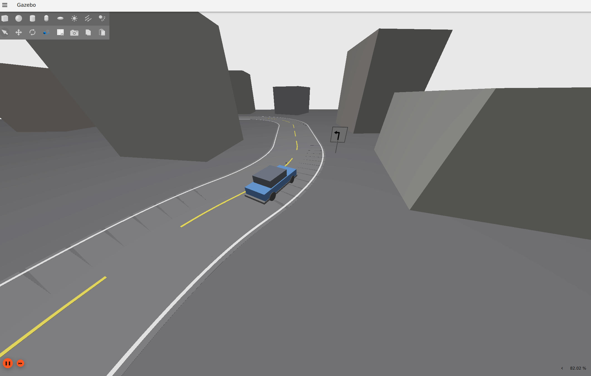
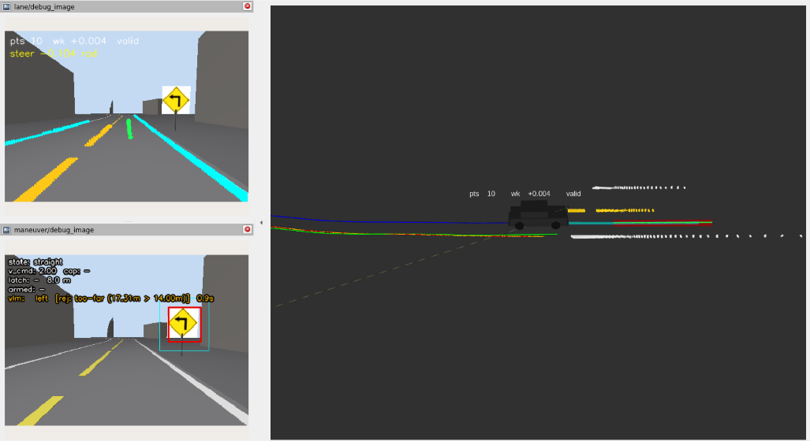

# vlm_av_ws

A ROS2 + Gazebo autonomous-driving simulation stack: vision-based lane perception, a curvature-aware local planner, and an OSQP QP model-predictive controller, running a full-size sedan through a generated urban road course.
A second pipeline layers a vision-language model on top: it reads road signs (stop / left / right / winding) from the front camera and turns them into speed caps and a stop, on top of the vision-only lane following.
A third, independent layer adds safety: an automatic emergency braking (AEB) node that watches the depth camera for obstacles in the car's predicted path, and a control arbiter that decides which command actually reaches the car.
The VLM pipeline and the AEB layer run in two separate simulation setups, never together (see [Running it](#running-it)).

This project is a continuation of [kfan12/vlm_robot_public](https://github.com/kfan12/vlm_robot_public).
It carries forward the same ROS2/Gazebo simulation approach, now built around a full-size sedan model (Ackermann steering, RGB-D front camera) instead of the original robot, and a more realistic generated road world with lane markings, curves, intersections, and street furniture.

**Status: under active development.**
The core stack runs end to end (perception -> planning -> control -> sim), and the VLM sign-reading pipeline (Qwen2.5-VL-3B) runs alongside it and drives the demo course (straight -> right 90 -> winding S -> left 90 -> STOP).
Tuning and new features are ongoing; expect frequent changes to camera/perception parameters, MPC weights, VLM sign-arbitration tuning, and the road-world generator as the project evolves.

## Screenshots

| Gazebo simulation | RViz (lane debug image + planned path) |
| --- | --- |
|  |  |

## Stack overview

| Package | Role |
| --- | --- |
| `sedan_description` | V2 full-size sedan URDF: 2.7 m wheelbase, Ackermann steering, windshield-height RGB-D camera. |
| `urban_gazebo` | Generated urban world/course tooling: road geometry, lane paint, signage, traffic-light control. |
| `robot_bringup` | Top-level launch files, `ros_gz` bridge configs, RViz config. |
| `av_perception_cpp` | `lane_node`: HSV-based lane-paint detection, chain clustering/merging, ground-plane projection, debug image/markers. |
| `av_behavior_cpp` | `local_planner` (curve splicing + speed profiling) and `mpc_tracker_v2` (OSQP QP tracker on a linearized bicycle model). |
| `robotcar_localization` | EKF configuration (`robot_localization`) fusing wheel odometry and IMU. |
| `av_common_cpp` | Shared C++ library: geometry/polyline math, projection, JSON map I/O, debug tap. |
| `vlm_planner_py` | VLM sign pipeline: `vlm_sign_node` (Qwen2.5-VL-3B sign reading) + `sign_maneuver_node` (board detection, sign-to-speed arbitration). Runs under a separate Python venv (torch); see below. |
| `av_safety_cpp` | `aeb_node`: depth-camera obstacle clusters, swept collision corridor along the predicted path, TTC / safe braking distance, six-state AEB state machine. |
| `av_control_cpp` | `control_arbiter_node`: the single command authority for `/cmd_vel` when AEB is on (e-stop > AEB > fault stop > MPC). |
| `av_feature_msgs` | Typed feature interfaces (`AebStatus.msg`). |

Perception, planning, and control run as separate ROS2 nodes at their own rates, tied together through `av_stack.launch.py`, which also fans out the map's spawn pose so every node agrees on the same odom-frame origin.
The VLM pipeline runs as two extra nodes launched separately (not part of `av_stack.launch.py`, since it needs the torch venv) and only ever *caps* speed or adds a stop - it never steers, so the stack still drives lane-only with it off.

```
camera (RGB + depth) --> lane_node --> local_planner --> mpc_tracker_v2
                                                              |
             VLM setup (aeb:=false):                          +--> /cmd_vel
             AEB setup (aeb:=true):                           +--> /control/mpc_cmd --> control_arbiter --> /cmd_vel
                                                                   aeb_node --> /safety/aeb_status, /control/aeb_cmd --^
```

## VLM sign pipeline

Two nodes, both under `vlm_planner_py`, run in the torch venv alongside (not inside) `av_stack.launch.py`:

- **`vlm_sign_node`** - subscribes to the front camera, classifies the nearest/latched road sign with Qwen2.5-VL-3B-Instruct (4-bit, on its own ~0.5 Hz timer since inference takes ~2 s) and publishes `/vlm/sign` (`{"sign": <label>, "stamp": <capture time>}`, label in `{right,left,winding,stop,none,unparsed}`) plus an annotated `/vlm/sign_image`.
  It loads the model at startup, not on first frame, because the cold load (~2-3 min) pegs the CPU and would otherwise starve the Gazebo camera render and trip the MPC's path-stale safety.
- **`sign_maneuver_node`** - detects candidate sign boards from the depth image (elevated blob + color gate), latches one board by odom position, hands its pixel ROI to `vlm_sign_node` so Qwen reads the latched board instead of the nearest board-shaped thing, and runs the v1 `SignLabelLatch` / `ManeuverStateMachine` arbitration on the result.
  It publishes `/maneuver/target_speed` (absolute setpoint) and `/maneuver/state` (state name); `mpc_tracker_v2` takes `min(planner speed profile, this setpoint)`, so a sign can only lower speed, never steer or raise it.
  A `left`/`right` state also selects the MPC's turn-mode heading lookahead.
  `/vlm/sign_maneuver` publishes the full diagnostic JSON (maneuver, speed cap, stop distance, sign latch state) for the demo's narrative pane.

Tunables (camera geometry, board-detection z/x/y bands, color gate, label band, cruise/turn/winding speed caps, stop creep + standoff) live in `src/vlm_planner_py/config/sign_maneuver_params.yaml`; copy it per tuning cycle rather than editing code.

Requires a Python venv with `torch`, `transformers`, and (for the 4-bit GPU path) `bitsandbytes` - default location `~/venvs/vlm_robot` (override with `VLM_VENV`).
Without a CUDA GPU, Qwen falls back to full-precision CPU inference, which is slow enough to be impractical for the live demo.

Run it manually (two extra terminals, after `av_stack.launch.py` is up):

```bash
source ~/venvs/vlm_robot/bin/activate
python3 -m vlm_planner_py.vlm_sign_node --ros-args -p use_sim_time:=true -p vlm_query_rate_hz:=0.5
# wait for the "VLM ready" log line, then:
python3 -m vlm_planner_py.sign_maneuver_node --ros-args \
    --params-file src/vlm_planner_py/config/sign_maneuver_params.yaml -p use_sim_time:=true
```

Toggle Qwen querying live, without restarting: `ros2 param set /vlm_sign vlm_query_enabled false|true`.

## AEB safety layer

Two C++ nodes, started by `av_stack.launch.py` when `aeb:=true` (the default):

- **`aeb_node`** (`av_safety_cpp`) - an independent safety monitor at 20 Hz.
  It clusters obstacle points from the depth image (ground removed, height and range gated), sweeps the car's footprint along the predicted path (the MPC's path, extended by a kinematic prediction so a stopped car still sees what is in front of it), and computes time-to-collision and safe braking distance for the nearest obstacle in that corridor.
  A six-state machine (`INACTIVE`, `MONITORING`, `WARNING`, `BRAKING`, `STOP_HOLD`, `FAULT`) turns that into `/safety/aeb_status` (`av_feature_msgs/AebStatus`: state, emergency flag, distance, TTC, requested deceleration, reason) and an emergency command on `/control/aeb_cmd`.
  Stale depth or odometry puts it in `FAULT`, and a fault never releases an active brake or hold.
  For RViz it publishes `/safety/aeb/debug_image`: the front camera with the swept corridor of both predicted paths, the `d_safe` braking line, obstacle clusters (orange inside the corridor, red with its distance for the nearest one), and a state-coloured banner with distance / TTC / `d_safe` (param `debug_image`, view only - the safety logic never reads the RGB frame).
- **`control_arbiter`** (`av_control_cpp`) - the only node allowed to publish `/cmd_vel` in this setup.
  Each tick it picks one source by priority: manual e-stop (`/safety/manual_estop`) > AEB emergency (`/control/aeb_cmd`) > stop if the AEB status is missing or in `FAULT` > the MPC's nominal command (`/control/mpc_cmd`) > stop.
  So no AEB means no driving, never "drive on unprotected".
  It reports its choice on `/control/active_source`, shown in RViz as a `ctrl: <source>` label above the car.

Tunables live in `src/av_safety_cpp/config/aeb_params.yaml` (camera geometry, obstacle gating, corridor margins, TTC thresholds, braking model, staleness timeouts) and `src/av_control_cpp/config/control_arbiter_params.yaml` (timeouts, speed / yaw-rate clamp); pass a copy with `aeb_config:=` / `arbiter_config:=`.
Purpose-built test worlds put a barrier on the course: `urban_course_roadblock` (barrier in the ego lane 32 m after spawn) and `urban_course_roadblock_oncoming` (barrier in the oncoming lane, which must *not* trigger braking).

## Running it

Build first:

```bash
colcon build --symlink-install
source install/setup.bash

# scripts/ can lose the executable bit (e.g. after a Windows-side checkout);
# re-set it if you get "Permission denied":
chmod +x ./scripts/*.sh
```

### Two simulation setups

The VLM pipeline and the AEB layer never run together; pick one setup per run:

| Setup | Speed source | `av_stack.launch.py` | Who publishes `/cmd_vel` |
| --- | --- | --- | --- |
| **vlm** | VLM sign chain (`/maneuver/target_speed` from `sign_maneuver_node`) | `aeb:=false` - no `aeb_node`, no arbiter | `mpc_tracker_v2` |
| **aeb** | fixed `/maneuver/target_speed` (no VLM) | `aeb:=true` (default) - `aeb_node` + `control_arbiter` | `control_arbiter` |

Without anything on `/maneuver/target_speed`, the MPC deliberately holds the car at 0.

### Demo (terminator grid)

`scripts/start_course_demo.sh [vlm|aeb]` lays out a 3x2 `terminator` grid (needs `terminator` and an X server; WSLg on Windows 11 provides one):

| Pane | vlm setup | aeb setup |
| --- | --- | --- |
| 1 | VLM pipeline (venv): `vlm_sign_node`, then `sign_maneuver_node` once Qwen is loaded | fixed `/maneuver/target_speed` publisher |
| 2 | `av_stack.launch.py aeb:=false`, held until Qwen is loaded | `av_stack.launch.py aeb:=true` |
| 3 | sign / maneuver narrative (`/vlm/sign_maneuver`) | every `/safety/aeb_status` state change + 1 Hz heartbeat |
| 4 | `/maneuver` setpoint + raw `/vlm/sign` | arbiter's active source + `/cmd_vel` |
| 5 | topic-rate health (camera, depth, lane path, sign reads) | topic-rate health (camera, depth, lane path, AEB status, `/cmd_vel`) |
| 6 | free shell with handy commands | free shell with handy commands |

```bash
./scripts/start_course_demo.sh                    # vlm setup (default)
STACK_NOWAIT=1 ./scripts/start_course_demo.sh     # don't wait for Qwen before starting the sim
DEMO_WORLD=urban_tight ./scripts/start_course_demo.sh

./scripts/start_course_demo.sh aeb                # aeb setup, default world urban_course_roadblock
DEMO_WORLD=urban_course_roadblock_oncoming ./scripts/start_course_demo.sh aeb
DEMO_SPEED=2.0 ./scripts/start_course_demo.sh aeb # lower speed cap (default 8.0 = planner profile governs)
```

RViz shows each setup's own views: the lane debug image in both, plus `/maneuver/debug_image` (VLM sign view) in the vlm setup, or `/safety/aeb/debug_image`, the AEB obstacle / corridor markers and the arbiter's `ctrl:` label in the aeb setup.
Other env vars: `DEMO_RVIZ=false`, `DEMO_CURVE_SPLICE=true`, `VLM_VENV`; the header of `scripts/start_course_demo.sh` documents them all.
Teardown is closing the terminator window; each pane's job dies with it.

### Stack only (launch args directly)

```bash
# aeb setup: Gazebo + sedan + bridge + EKF + perception + planning + MPC + aeb_node + arbiter + RViz
ros2 launch robot_bringup av_stack.launch.py
ros2 topic pub -r 10 /maneuver/target_speed std_msgs/msg/Float64 '{data: 8.0}'   # second terminal: let it drive

# vlm setup: same without aeb_node / arbiter, then start the two VLM nodes (see above)
ros2 launch robot_bringup av_stack.launch.py aeb:=false

# a tighter-radius course, a barrier world, or without RViz
ros2 launch robot_bringup av_stack.launch.py world:=urban_tight
ros2 launch robot_bringup av_stack.launch.py world:=urban_course_roadblock
ros2 launch robot_bringup av_stack.launch.py rviz:=false

# tune without touching code
ros2 launch robot_bringup av_stack.launch.py mpc_config:=/path/to/mpc_params_tuned.yaml
ros2 launch robot_bringup av_stack.launch.py aeb_config:=/path/to/aeb_params_tuned.yaml
```

See the docstring of `src/robot_bringup/launch/av_stack.launch.py` for the full set of launch arguments (lane-detection debug surfaces, the local planner's road-curvature assist, etc).

### Recorded laps and AEB scenarios

| Script | What it does |
| --- | --- |
| `scripts/run_headless_lap.sh novlm\|vlm LABEL [DURATION_S] [WORLD]` | One reproducible headless lap: kills leftovers, launches the stack (`novlm` = aeb setup, `vlm` = vlm setup with the real sign chain), records, cleans up. |
| `scripts/record_av_lap.sh --label L --duration S --world W` | Records a lap from a running stack into `data/av_laps/<session>/`. |
| `scripts/analyze_av_lap.sh latest --plots` | Cross-track error, speed tracking, completion, AEB events -> `metrics.json`, `report.md`, `lap.png`; a change is a regression only relative to a recorded baseline lap. |
| `scripts/record_aeb_scenario.sh --label L --duration S --world W --target-speed V` | Records an AEB scenario (status, distance, TTC, commands) into `data/aeb_scenarios/<session>/`. |
| `scripts/analyze_aeb_scenario.sh latest --plots` | Metrics for a recorded scenario (AEB distance vs. ground-truth bumper gap to the barrier, state timeline) -> `metrics.json`, `report.md`, plots. |

```bash
./scripts/run_headless_lap.sh novlm my_lap 240        # aeb setup, planner speed
./scripts/run_headless_lap.sh vlm my_vlm_lap 320      # vlm setup (needs the torch venv)
./scripts/analyze_av_lap.sh latest --plots
```

`tools/avkit/aeb_test_driver.py` drives AEB scenarios: a fixed target speed, optional stop at a given x or on BRAKING, barrier removal after a hold, and resume.

## Roadmap

This is a work in progress.
Planned areas of continued work include further MPC/perception tuning, further VLM sign-arbitration robustness (board latch, ROI hand-off) tuning, closed-loop AEB scenario testing with the arbiter, a composable velocity-constraint coordinator (so features like ACC or a stop line plug in without another `min()` in the MPC), additional road-world variety, and expanded sensing/behavior features.
